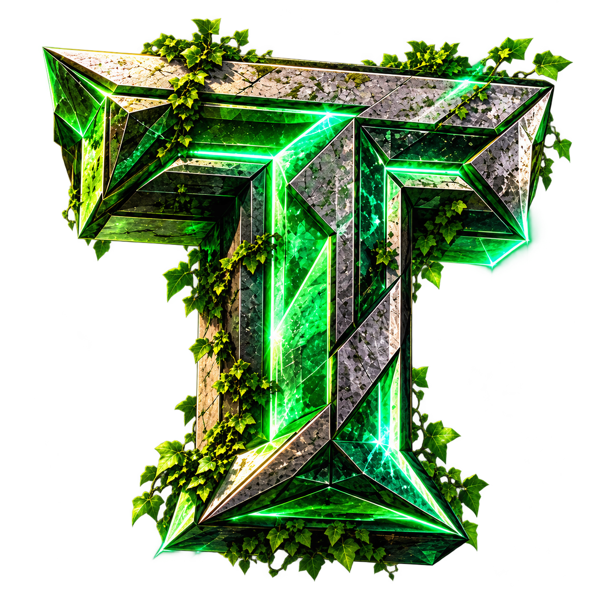

<div align="center">



# TALQORIA

**Minecraft Survival+ · поселения, экономика и приключения**

Сервер, в котором игроки создают собственные поселения, исследуют мир и развиваются вместе.

[](https://github.com/Zeihos/Talqoria/actions/workflows/verify.yml)


[Возможности](#возможности) · [Начать работу](#быстрый-старт) · [Структура](#структура-проекта) · [План разработки](docs/ROADMAP.md) · [Как помочь](CONTRIBUTING.md)

</div>


> [!IMPORTANT]
> **TALQORIA находится в разработке.** TalqoriaCore **0.18.0** собирается в GitHub Actions, но эта версия ещё не подтверждена как полностью протестированная на игровом сервере. Публичный релиз 1.0 **не объявлен**. Не используйте альфа-сборку для сервера с важными данными без резервных копий.

## О проекте

TALQORIA — самостоятельный Minecraft-проект в направлении **Survival+**. Классическое выживание дополняется поселениями и приватами, внутриигровой экономикой, ежедневными заданиями и системой развития. Код Minecraft-плагина, сайт и серверный API развиваются в одном репозитории.

Наша цель — не набор случайных плагинов, а целостный игровой мир с понятной прогрессией, собственными механиками и аккуратным интерфейсом.

## Возможности

| Направление | Что реализовано в исходниках |
|:--|:--|
| **Поселения** | Создание городов, приглашения, роли владельца и офицеров, рост уровня |
| **Территории** | Приват чанков, права участников и гостей, защита строительства и автоматических перемещений через границы |
| **Экономика** | Баланс, переводы, ежедневные награды и сохранение кошельков |
| **Задания** | Ежедневные цели, путь новичка, прогресс и награды |
| **Безопасность** | Защита спавна, журнал действий персонала, блокировка операций при повреждении данных |
| **Сайт и API** | Прототип сайта, новости, информация о сервере через защищённый статусный канал |

**Торговля предметами в альфа-версии выключена по умолчанию:** требуется дополнительная проверка сохранения предметов и монет при сбоях.

<details>
<summary><b>Основные команды игроков</b></summary>

| Команда | Назначение |
|:--|:--|
| `/tq help` | Справка |
| `/tq profile` | Профиль |
| `/tq balance` | Баланс |
| `/tq daily` | Ежедневная награда |
| `/tq spawn` | Возврат на спавн |
| `/tq town` | Поселения и участники |
| `/tq quest` | Ежедневные задания |
| `/tq shop` | Каталог рынка (торговые операции могут быть отключены) |
| `/tq journey` | Путь новичка |

Базовые команды проходили ручную проверку на v0.11. Для v0.18 необходим повторный интеграционный тест на настоящем Paper.

</details>

## Быстрый старт

**Понадобятся:** JDK для выбранной версии Paper (при тестировании Paper 26.3 использовалась Java 25), Maven 3.9+ для сборки и Node.js 20+ для сайта/API. Исходный код плагина компилируется с `--release 21`.

```bash
git clone https://github.com/Zeihos/Talqoria.git
cd Talqoria
```

**Windows:** запустите `BUILD_PLUGIN_WINDOWS.bat` — скрипт соберёт TalqoriaCore и поместит JAR в `server/plugins/`. Для сайта используйте `START_SITE_WINDOWS.bat`.

**Linux / любая ОС с Maven:**

```bash
mvn -f plugin/pom.xml clean package
node --test backend/test/*.test.js
```

Для запуска Minecraft-сервера потребуется отдельно скачать совместимый `paper.jar` с [PaperMC](https://papermc.io/downloads/paper). Скрипты сервера расположены в `server/`. Перед запуском выполните `PREFLIGHT_WINDOWS.bat` или `node tools/preflight.js .`.

**Подробная инструкция:** [установка, конфигурация и обновление](docs/INSTALL.md).

> **Совместимость:** текущий Maven-проект использует зависимость `paper-api:1.21.11-R0.1-SNAPSHOT`. Успешная сборка с этой API-зависимостью не гарантирует совместимость с Paper 26.3 — её нужно проверить отдельно.

## Структура проекта

```text
TALQORIA/
├── plugin/                 # TalqoriaCore · Java / Maven
├── backend/                # Node.js API, новости, тесты
├── site/                   # HTML, CSS, JavaScript
├── server/                 # Шаблоны и скрипты запуска Paper
├── tools/                  # Проверка окружения, диагностика, Maven
├── assets/                 # Логотип, оформление и изображения
├── docs/                   # Документация
└── .github/                # GitHub Actions и шаблоны обращений
```

## Сборки и проверка качества

В GitHub Actions автоматически выполняются проверки хранилища блоков, офлайн-инспектора, JUnit-тесты кошельков, заданий, поселений и пересечения границ приватных участков, тесты Node.js, контроль структуры репозитория и сборка TalqoriaCore с Paper API. Локально качество структуры можно проверить командой `node tools/repo-check.js`. Если сборка завершилась успешно, тестовый JAR можно найти в **Actions → Verify Talqoria → Artifacts** (`TalqoriaCore-dev`).

Это **сборка для тестирования**, а не подтверждённый игровой релиз. Перед обновлением сервера обязательно остановите Paper и сохраните мир и данные `plugins/TalqoriaCore/`.

## План разработки

| Этап | Состояние |
|:--|:--|
| Базовые команды, экономика и поселения | Реализованы в коде |
| Сборка Java-плагина и API-тесты | Автоматизированы |
| Защита сохранений и безопасные границы поселений | Реализованы в коде v0.13–0.18 |
| Игровые испытания 0.18 и тесты сохранений | **В работе / требуют подтверждения** |
| Безопасная торговля и закрытый альфа-тест | **Впереди** |
| Стабильная публичная версия 1.0 | **Не выпущена** |

Полный план: **[docs/ROADMAP.md](docs/ROADMAP.md)**.

## Участие в разработке

Нашли ошибку, хотите предложить улучшение или помочь с кодом? Используйте [Issues](https://github.com/Zeihos/Talqoria/issues) и [Pull Requests](https://github.com/Zeihos/Talqoria/pulls). Перед отправкой прочитайте **[CONTRIBUTING.md](CONTRIBUTING.md)**.

Пожалуйста, **не публикуйте** токены, файлы игроков, приватные данные и полные серверные архивы в открытых обращениях. Прочитайте [правила безопасности](SECURITY.md) и [историю изменений](CHANGELOG.md).

<details>
<summary><b>Лицензия и хранение данных</b></summary>

Лицензия на использование кода пока не выбрана. Публичный доступ к репозиторию сам по себе не предоставляет разрешения на копирование и распространение проекта на условиях open source.

Сохранения Minecraft, данные аккаунтов, журналы и файлы мира не относятся к исходному коду и не должны попадать в Git. Для состояния до очистки репозитория сохранена историческая ветка `backup/pre-cleanup-20261117`; в публичной истории Git могут оставаться данные прежних тестов.

</details>

<div align="center">

**TALQORIA · создаём свой мир**

<sub>Разработка проекта · Developer Alpha</sub>

</div>
